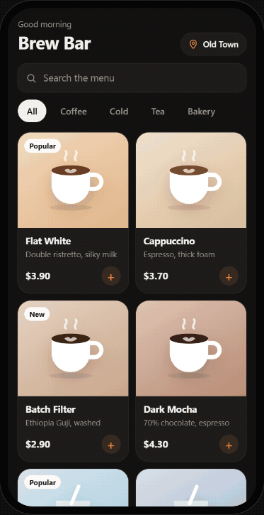
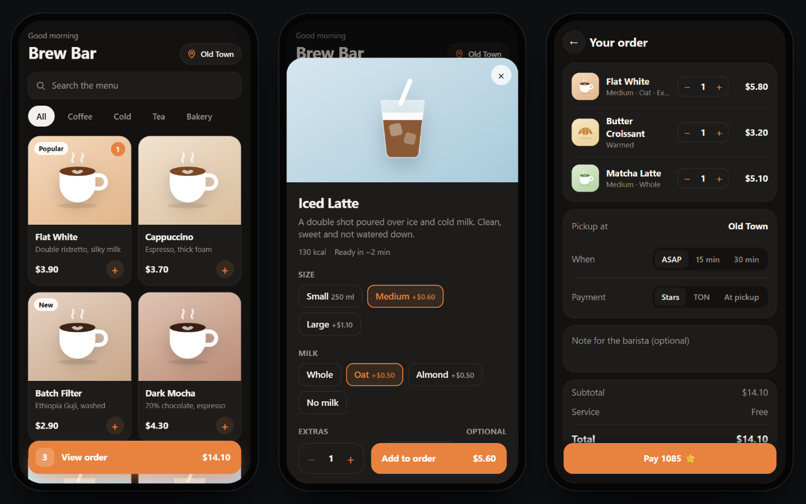

# Brew Bar — an ordering mini app for Telegram

A complete order-ahead flow that runs inside a Telegram chat: catalogue, product options, cart, checkout, and a bot that receives the order. No framework and no dependencies, on either side.

**[Open the live demo](https://eliezercombi.github.io/brew-bar/)** (it also runs in a normal browser tab)

<p></p>



## What is in here

| Part | What it does |
| --- | --- |
| `webapp/` | The mini app. Plain HTML, CSS and ES modules, about 12 KB gzipped. |
| `bot/bot.mjs` | The bot. Long polling on the Bot API plus one HTTP endpoint, using only Node built-ins. |
| `bot/pricing.mjs` | Rebuilds every order from the menu on the server, so a modified client cannot change a price. |
| `bot/verify.mjs` | Checks the `initData` signature Telegram attaches to each launch. |
| `test/` | Tests for pricing and signature checks. |

## Details worth a look

- **Follows the user's theme.** Colours come from Telegram's `--tg-theme-*` variables, with a light and dark fallback for the browser.
- **Uses the native controls.** Main button for payment, back button on checkout, haptic feedback on taps and selections.
- **Works for every launch type.** Opened from a keyboard button, the order goes back through `sendData`. Opened from the menu button or an inline button, it is posted to the bot's endpoint with the signed `initData`.
- **Stars checkout.** Choosing Stars sends an `XTR` invoice and answers the pre-checkout query. TON and pay-at-pickup are recorded on the order.
- **Money is integer cents** from the menu file to the receipt.
- **Accessible.** Real buttons, labelled controls, focus states, and animations that respect `prefers-reduced-motion`.

## Run it

You need Node 20 or newer.

```bash
npm test                 # 10 tests, no install step
npm run serve            # mini app on http://localhost:8080
```

To connect a real bot, create one with [@BotFather](https://t.me/BotFather), host `webapp/` on any HTTPS static host, then:

```bash
BOT_TOKEN=123456:ABC... WEBAPP_URL=https://your-host.example/ npm start
```

Send `/start` to the bot and tap **Open the menu**.

| Variable | Required | Meaning |
| --- | --- | --- |
| `BOT_TOKEN` | yes | Token from BotFather |
| `WEBAPP_URL` | yes | Where `webapp/` is hosted |
| `STAFF_CHAT_ID` | no | Chat that receives a copy of each order |
| `PORT` | no | Port of the order endpoint, default `8080` |
| `STAR_USD` | no | Dollar value of one Star used for invoices, default `0.013` |

For menu-button launches, open the app with `?api=https://your-bot-host.example` so it knows where to post orders.

## Making it yours

The menu lives in `webapp/menu.js`: items, option groups and price additions. The bot imports the same file, so the two cannot drift apart. Swap the SVG illustrations for photos by changing `artFor`.

## Licence

MIT
